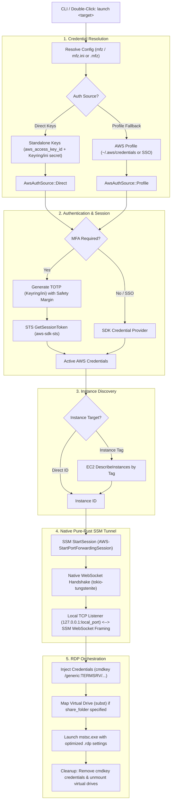

# MFZ Developer Documentation 🛠️

This document contains technical details, architecture overviews, and advanced configuration for the **MFZ** tool. For a general overview and quick start, please see [README.md](./README.md).

---

## 🏗️ Technical Architecture

MFZ is built in Rust to provide a high-performance, completely self-contained binary with **zero external runtime dependencies** (no AWS CLI, no `session-manager-plugin`). It orchestrates three primary AWS services:

1. **IAM/STS**: For session token acquisition and identity verification via native AWS Rust SDK (`aws-sdk-sts`).
2. **SSM (Systems Manager)**: For creating secure WebSocket-based tunnels for port forwarding via native Rust implementation (`src/ssm_tunnel.rs` and `src/ssm.rs`).
3. **EC2**: For dynamic instance discovery and state verification (`aws-sdk-ec2`).

### Flow Diagram



---

## ⚡ Zero External Dependencies Engine

Previous architectures relied on spawning `aws.exe` and `session-manager-plugin` as external child processes. MFZ eliminates these dependencies entirely:

1. **Native STS Authentication (`src/mfa.rs` & `src/credentials.rs`)**:
   - STS calls are made directly via `aws-sdk-sts`.
   - Standalone direct credentials (`aws_access_key_id`, `aws_secret_access_key`, and `region`) bypass AWS CLI profile configuration entirely.
   - Profile resolution directly parses `~/.aws/credentials` and `~/.aws/config` or delegates to the AWS SDK SSO provider when configured.

2. **Native WebSocket SSM Port-Forwarding Tunnel (`src/ssm_tunnel.rs`)**:
   - Invokes `ssm.start_session()` with document `AWS-StartPortForwardingSession` to obtain a `SessionId`, `StreamUrl`, and `TokenValue`.
   - Establishes a TLS WebSocket connection directly to the AWS Systems Manager gateway.
   - Implements AWS Systems Manager binary message framing:
     - 4-byte header length, 32-byte message type, 8-byte sequence number, flags, UUID, SHA-256 payload digest, and binary payloads.
     - Authenticates with the `TokenValue` JSON frame and completes the agent's port-session handshake before signaling listener readiness.
     - Bridges local TCP sockets through smux v1 and SSM WebSocket framing with bounded queues in both directions.
     - Batches ready 1 KiB SSM data messages without a fixed sleep, protects sequence-span credit after selective ACKs, and retries bounded gap probes with adaptive RTT/Karn/backoff and original wire bytes.
     - Keeps ACK/Pong/control traffic progressing independently of backpressured TCP consumers.
     - Owns all child tasks so stop/error/abort cannot leave detached connections running.

### Native Transport Performance and Tests

The native transport's regression suite can run without AWS credentials or Windows integration:

```bash
cargo test --manifest-path tools/transport-tests/Cargo.toml --locked
cargo clippy --manifest-path tools/transport-tests/Cargo.toml --locked --all-targets -- -D warnings
```

It compiles the actual production transport modules, including local TCP/WebSocket tests with concurrent transfers, queue saturation, loss/retry, and cancellation. Add `--features session-sdk` to include the actual MFA/session SDK modules and real-SDK loopback tests (no AWS account). The complete Windows-target application type-check also passed; type-checking is not Windows execution or live AWS/RDP validation.

See the [production-completion report](./docs/native-production-completion.md) for native remote cleanup, signing-region/readiness fixes, validation and the required `ssm:TerminateSession` permission.

See [the current performance report](./docs/native-transport-performance.md) for the official-plugin comparison, limits and measured benchmarks; [the harness README](./tools/transport-tests/README.md) for actual AWS-vendored Go smux interoperability; and [the original investigation](./docs/native-transfer-fix.md) for the whole-VM diagnostic checklist.

---

## ⚙️ Advanced Configuration

### Configuration Schema (`mfz` / `mfz.ini`)

| Key | Type | Default | Description |
| :--- | :--- | :--- | :--- |
| `aws_access_key_id` | String | None | AWS Access Key ID for 100% standalone mode (no `~/.aws/credentials` needed). |
| `aws_secret_access_key` | String | None | AWS Secret Access Key. *Recommendation: Store in Keyring via `mfz env secure` or `mfz env set-aws-secret`*. |
| `region` | String | `ap-northeast-1` | AWS Region for the environment (overridable via `--region`). |
| `profile` | String | None | Legacy fallback: AWS profile name in `~/.aws/credentials`. Required if `aws_access_key_id` omitted. |
| `auth_type` | Enum | Auto | `Mfa` or `Sso`. Inferred by presence of `serial`. |
| `serial` | String | None | IAM Virtual MFA ARN (e.g., `arn:aws:iam::...:mfa/user`). |
| `secret` | String | None | Base-32 shared secret. *Recommendation: Use `mfz env secure`*. |
| `instance` | String | None | Target AWS Instance ID. |
| `instance_tag` | String | None | Discovery query (e.g., `Name=Jump-Host`). |
| `remote_port` | u16 | 3389 | The port listening on the target instance. |
| `local_port` | u16 | 3389 | The local port to bind the SSM tunnel to. |
| `rdp_host` | String | (Required) | Friendly name for the RDP connection. |
| `rdp_user` | String | None | Auto-fill username for RDP. |
| `rdp_password` | String | None | Auto-fill password (stored in Windows Credential Manager if secured). |
| `shared_drives` / `share_drives` | String | None | Local drives to redirect (`*`, `C:;D:`, or `none`). |
| `shared_folder` / `share_folder` | String | None | Dedicated local directory path to map and redirect via virtual drive. |
| `fullscreen` | Boolean | `true` | Open RDP session in fullscreen mode. Set `false` for windowed mode. |
| `optimize` | String | `none` | Optimization profile: `speed`, `balanced`, `quality`, or `none`. |
| `audio` | Boolean | Profile default | Override audio redirection (`true` = play locally, `false` = mute). |
| `wallpaper` | Boolean | Profile default | Override desktop wallpaper display (`true` = show, `false` = disable). |
| `font_smoothing` | Boolean | `true` | Override clear font smoothing. |

---

## 🔒 Security Implementation

### Keyring Integration

MFZ uses the `keyring` crate with native Windows Credential Manager support (`windows-native`).

- **Namespace**: `mfz-cli`
- **Keys**: `aws-secret-<env>`, `totp-secret-<env>`, and `rdp-password-<env>`
- **Behavior**: Plain-text values in `mfz.ini` act as overrides. Running `mfz env secure <env>` (or `mfz config secure <env>`) migrates all plain-text secrets (AWS secret key, TOTP secret, RDP password) to the Windows Credential Manager and clears them from `mfz.ini`.
- **Targeted Key Management**:
  - `mfz env set-aws-secret <env>`: Securely prompts and stores AWS Secret Access Key without touching disk.
  - `mfz env set-totp-secret <env>`: Securely stores MFA TOTP seed.
  - `mfz env set-rdp-password <env>`: Securely stores Windows Administrator/RDP password.

### MFA Safety Margin

To prevent session expiration during login, MFZ implements a **Safety Margin** (default: 5s). If the current TOTP window is about to expire, the tool will pause and wait for the next window to ensure a fresh 30-second token is used for the AWS API call.

---

## 🖥️ Windows Shell Association (`.mfz`)

MFZ registers custom file associations in the Current User registry hive (`HKCU\Software\Classes`), requiring zero administrative rights or UAC prompts:

- `HKCU\Software\Classes\.mfz` -> `(Default) = "mfz.session"`
- `HKCU\Software\Classes\mfz.session` -> `(Default) = "MFZ Remote Desktop Profile"`
- `HKCU\Software\Classes\mfz.session\DefaultIcon` -> `(Default) = "<mfz.exe or icon.ico>"`
- `HKCU\Software\Classes\mfz.session\shell\open\command` -> `(Default) = "\"<mfz.exe>\" launch \"%1\""`

### File Resolution Strategy

When `mfz launch <input>` runs, it checks whether `<input>` is a file or environment name:

1. **Pointer File**: If the file defines `env = <name>` or `environment = <name>`, it loads section `[<name>]` from `mfz.ini`.
2. **Standalone Profile**: If the file defines configuration keys directly (`profile = ...`, `instance = ...`, `rdp_host = ...`), MFZ loads it as a standalone `EnvironmentConfig` without needing `mfz.ini`.
3. **File Stem Fallback**: If the file is 0-bytes or has no keys, MFZ extracts the file stem (e.g. `stg.mfz` -> `stg`) and loads `[stg]` from `mfz.ini`.
4. **Environment Name**: Standard lookup from `mfz.ini`.

---

## 🛠️ Development & Building

### Prerequisites

- Current stable Rust (the locked AWS transport dependencies require v1.91.1+)
- Windows 10/11 environment (for native Credential Manager, RDP `mstsc.exe`, and registry shell association)

### Build & Test Commands

```bash
# Debug build
cargo build

# Production build (optimized with icon resources)
cargo build --release

# Run all automated tests
cargo test

# Run linting
cargo clippy

# Formatting
cargo +nightly fmt
```

### Windows Resources

The project uses `winres` to embed version metadata and the `icon.png` into the `mfz.exe` binary. Configuration is handled in `build.rs`.

---

## 👤 Author

**Waka** — [ta@e-technostar.com](mailto:ta@e-technostar.com)
