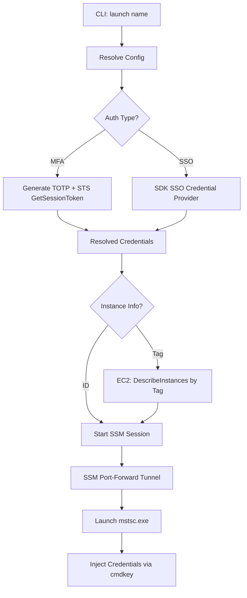

# MFZ Developer Documentation 🛠️

This document contains technical details, architecture overviews, and advanced configuration for the **MFZ** tool. For a general overview and quick start, please see [README.md](./README.md).

---

## 🏗️ Technical Architecture

MFZ is built in Rust to provide a high-performance, safe, and portable binary. It orchestrates three primary AWS services:

1. **IAM/STS**: For session token acquisition and identity verification.
2. **SSM (Systems Manager)**: For creating secure WebSocket-based tunnels for port forwarding.
3. **EC2**: For dynamic instance discovery and state verification.

### Flow Diagram



---

## ⚙️ Advanced Configuration

### `mfz.ini` Full Schema

| Key | Type | Default | Description |
| :--- | :--- | :--- | :--- |
| `profile` | String | (Required) | AWS CLI profile name. |
| `auth_type` | Enum | Auto | `Mfa` or `Sso`. Inferred by presence of `serial`. |
| `serial` | String | None | IAM Virtual MFA ARN (e.g., `arn:aws:iam::...:mfa/user`). |
| `secret` | String | None | Base-32 shared secret. *Recommendation: Use `mfz config secure`*. |
| `instance` | String | None | Target AWS Instance ID. |
| `instance_tag` | String | None | Discovery query (e.g., `Name=Jump-Host`). |
| `remote_port` | u16 | 3389 | The port listening on the target instance. |
| `local_port` | u16 | 3389 | The local port to bind the SSM tunnel to. |
| `rdp_host` | String | (Required) | Friendly name for the RDP connection. |
| `rdp_user` | String | None | Auto-fill username for RDP. |
| `rdp_password` | String | None | Auto-fill password (stored in Windows Credential Manager if secured). |
| `shared_drives` | String | `*` | Local drives to redirect (`*`, `C:;D:`, or `none`). |
| `shared_folder` | String | None | Dedicated local directory path to map and redirect via virtual drive. |
| `optimize_connection` | Boolean | `true` | Apply RDP bulk compression, bitmap caching, and LAN mode. |

---

## 🔒 Security Implementation

### Keyring Integration

MFZ uses the `keyring` crate to interface with the **Windows Credential Manager**.

- **Namespace**: `mfz-cli`
- **Keys**: `totp-secret-<env>` and `rdp-password-<env>`
- **Behavior**: Plain-text values in `mfz.ini` act as overrides. Running `config secure` migrates these to the OS-level store and clears them from the `.ini` file.

### MFA Safety Margin

To prevent session expiration during login, MFZ implements a **Safety Margin** (default: 5s). If the current TOTP window is about to expire, the tool will pause and wait for the next window to ensure a fresh 30-second token is used for the AWS API call.

---

## 🛠️ Development & Building

### Prerequisites

- Stable Rust (v1.70+)
- `cargo-edit` (optional, for dependency management)

### Build Commands

```bash
# Debug build
cargo build

# Production build (optimized with icon resources)
cargo build --release

# Run linting
cargo clippy

# Formatting
cargo +nightly fmt
```

### Windows Resources

The project uses `winres` to embed version metadata and the `icon.png` into the `mfz.exe` binary. Configuration is handled in `build.rs`.

---

## 👤 Author

**Waka** — [ta@e-technostar.com](mailto:ta@e-technostar.com)
