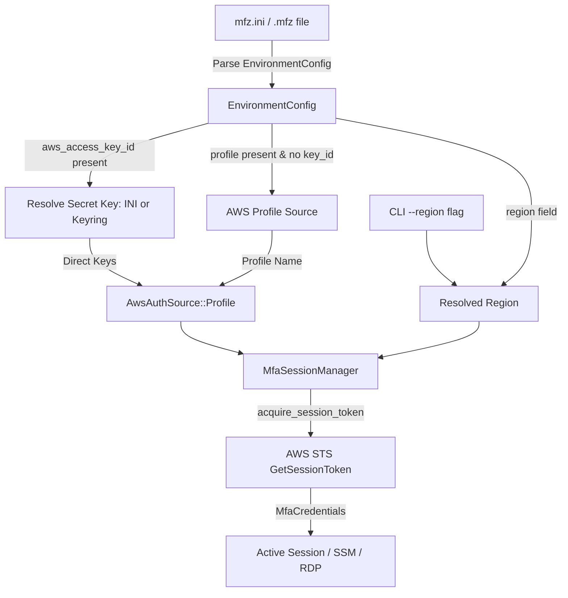

# Standalone `mfz.ini` Credentials Design

## Overview

Enable `mfz` to operate 100% standalone using direct AWS credentials specified in `mfz.ini` or stored securely in the Windows Keyring, removing any mandatory dependency on `~/.aws/credentials`, `~/.aws/config`, or AWS CLI tools, while retaining backwards compatibility for named profiles.

---

## Requirements & Goals

1. **Standalone AWS Authentication**:
   - Allow environments to specify `aws_access_key_id` and `aws_secret_access_key` directly in `mfz.ini`.
   - Support omitting `aws_secret_access_key` from `mfz.ini` and resolving it securely from the Windows Keyring (`aws-secret-<env>`).
2. **Backwards Compatibility**:
   - Continue supporting `profile = <name>` as a fallback for users who wish to authenticate via `~/.aws/credentials` or AWS SSO.
   - If neither `aws_access_key_id` nor `profile` is provided, return a clear, actionable validation error.
3. **Environment Region Support**:
   - Allow optional `region` per environment in `mfz.ini`, defaulting to `"ap-northeast-1"` if not specified. CLI flag `--region` retains highest precedence.
4. **Keyring Credential Management**:
   - Provide subcommands to set and clear AWS secret keys in Windows Keyring (`mfz creds set-aws-secret <env>`, `mfz creds clear <env>`).
5. **Standalone `.mfz` Export**:
   - Standalone `.mfz` profile exports should include `aws_access_key_id` and `region` so exported profiles are portable to machines without local AWS profiles configured.

---

## Architecture & Data Flow



---

## Detailed Component Design

### 1. Configuration & Storage (`src/config.rs`)

#### Schema Changes

`REQUIRED_KEYS` changes from `&["profile", "remote_port", "local_port", "rdp_host"]` to:

```rust
const REQUIRED_KEYS: &[&str] = &["remote_port", "local_port", "rdp_host"];
```

#### Struct Updates

```rust
pub struct EnvironmentConfig {
    pub profile: Option<String>,
    pub aws_access_key_id: Option<String>,
    pub aws_secret_access_key: Option<String>,
    pub region: Option<String>,
    pub auth_type: AuthType,
    pub serial: Option<String>,
    pub secret: Option<String>,
    pub instance: Option<String>,
    pub instance_tag: Option<String>,
    pub remote_port: u16,
    pub local_port: u16,
    pub rdp_host: String,
    pub rdp_user: Option<String>,
    pub rdp_password: Option<String>,
    pub shared_drives: Option<String>,
    pub shared_folder: Option<String>,
    pub optimize_connection: Option<bool>,
    pub fullscreen: Option<bool>,
    pub optimize: Option<String>,
    pub opt_audio: Option<bool>,
    pub opt_wallpaper: Option<bool>,
    pub opt_font_smoothing: Option<bool>,
}
```

#### Parsing & Validation

- Read `aws_access_key_id`, `aws_secret_access_key`, and `region`.
- If neither `aws_access_key_id` nor `profile` is present:

  ```rust
  return Err(AppError::Config(format!(
      "[{name}] must specify either `aws_access_key_id` (standalone) or `profile` (AWS profile)"
  )));
  ```

- Method `resolve_aws_secret_key(&self, env_name: &str) -> Result<Option<String>>`:
  - If `self.aws_secret_access_key` is `Some(k)`, return `Ok(Some(k))`.
  - If `self.aws_access_key_id.is_some()`, lookup in `CredentialStore::get_aws_secret_key(env_name)`:
    - If found, return `Ok(Some(k))`.
    - If `None`, return `Err(AppError::Config(format!("No AWS secret access key found for [{env_name}] in config or keyring")))`.
  - If `aws_access_key_id` is `None`, return `Ok(None)` (profile mode).

---

### 2. Keyring Store (`src/credentials.rs`)

Add entries for the AWS secret access key:

```rust
impl CredentialStore {
    pub fn set_aws_secret_key(env_name: &str, secret_key: &str) -> Result<()> {
        let entry = Entry::new("mfz-cli", &format!("aws-secret-{}", env_name))
            .map_err(|e| AppError::Config(format!("Keyring error: {e}")))?;
        entry
            .set_password(secret_key)
            .map_err(|e| AppError::Config(format!("Failed to save AWS secret key: {e}")))?;
        Ok(())
    }

    pub fn get_aws_secret_key(env_name: &str) -> Result<Option<String>> {
        let entry = Entry::new("mfz-cli", &format!("aws-secret-{}", env_name))
            .map_err(|e| AppError::Config(format!("Keyring error: {e}")))?;
        match entry.get_password() {
            Ok(p) => Ok(Some(p)),
            Err(keyring::Error::NoEntry) => Ok(None),
            Err(e) => Err(AppError::Config(format!("Failed to read AWS secret key: {e}"))),
        }
    }

    pub fn delete_secrets(env_name: &str) -> Result<()> {
        // Deletes totp-secret, rdp-password, and aws-secret for env_name
    }
}
```

---

### 3. Authentication Engine (`src/mfa.rs`)

#### Auth Source Representation

```rust
#[derive(Debug, Clone)]
pub enum AwsAuthSource {
    Direct {
        access_key_id: String,
        secret_access_key: String,
    },
    Profile(String),
}
```

#### `MfaSessionManager` Updates

```rust
pub struct MfaSessionManager {
    auth_source: AwsAuthSource,
    region: Option<String>,
    serial: Option<String>,
    secret: Option<String>,
    cached: Option<MfaCredentials>,
}
```

In `acquire_session_token(&self, spinner: Option<&Spinner>)`:

- Construct `StsClient`:
  - When `AwsAuthSource::Direct { access_key_id, secret_access_key }`:

    ```rust
    let static_creds = aws_sdk_sts::config::Credentials::new(
        access_key_id.clone(),
        secret_access_key.clone(),
        None,
        None,
        "mfz-direct",
    );
    let mut config_loader = aws_config::defaults(BehaviorVersion::latest())
        .credentials_provider(static_creds);
    if let Some(ref r) = self.region {
        config_loader = config_loader.region(aws_config::Region::new(r.clone()));
    }
    let config = config_loader.load().await;
    let client = StsClient::new(&config);
    ```

  - When `AwsAuthSource::Profile(profile)`:

    ```rust
    let mut config_loader = aws_config::defaults(BehaviorVersion::latest())
        .profile_name(profile);
    if let Some(ref r) = self.region {
        config_loader = config_loader.region(aws_config::Region::new(r.clone()));
    }
    let config = config_loader.load().await;
    let client = StsClient::new(&config);
    ```

---

### 4. CLI Execution & Display (`src/main.rs`, `src/cli.rs`)

#### Region Resolution

```rust
let resolved_region = args
    .region
    .clone()
    .or_else(|| env.region.clone())
    .unwrap_or_else(|| "ap-northeast-1".to_string());
```

#### Auth Source Resolution

```rust
let auth_source = if let Some(ref key_id) = env.aws_access_key_id {
    let secret_key = env.resolve_aws_secret_key(&env_name)?;
    let secret_key = secret_key.ok_or_else(|| {
        AppError::Config(format!(
            "Missing AWS secret access key for environment `{env_name}`"
        ))
    })?;
    AwsAuthSource::Direct {
        access_key_id: key_id.clone(),
        secret_access_key,
    }
} else if let Some(ref p) = env.profile {
    AwsAuthSource::Profile(p.clone())
} else {
    return Err(AppError::Config(format!(
        "Environment `{env_name}` must configure either `aws_access_key_id` or `profile`"
    )));
};
```

#### UI Feedback

Print authentication details dynamically:

- Direct Key: `print_kv("AWS Auth", &format!("Direct ({})", mask_key(key_id)));`
- Profile: `print_kv("AWS Profile", profile);`
- Region: `print_kv("Region", &resolved_region);`

---

## Testing & Verification Plan

1. **Config Parsing Unit Tests** (`tests/config_test.rs` or `src/config.rs` tests):
   - Verify parsing of standalone section with `aws_access_key_id`, `aws_secret_access_key`, and `region`.
   - Verify parsing of legacy section with `profile`.
   - Verify error when neither `aws_access_key_id` nor `profile` is provided.
   - Verify `resolve_aws_secret_key` reads from struct when present.
2. **Keyring Integration Test**:
   - Set AWS secret key in keyring via `CredentialStore::set_aws_secret_key`.
   - Read back via `CredentialStore::get_aws_secret_key`.
   - Verify `delete_secrets` removes the entry.
3. **End-to-End Build & Compilation**:
   - Run `cargo check` and `cargo test` to ensure clean build and no regressions.
